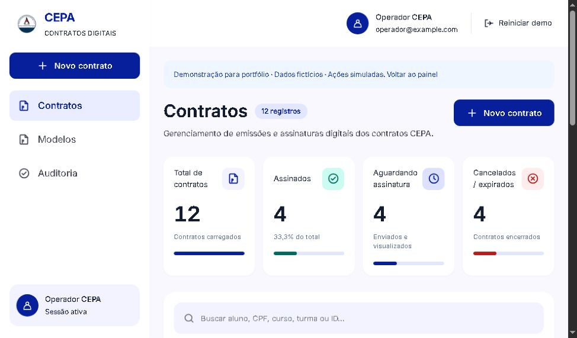
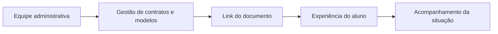

# CEPA · Contratos Digitais

**Gestão de contratos educacionais, modelos e acompanhamento da assinatura em uma aplicação web.**

[Abrir demonstração interativa](https://sistema-cepa-contratos.vercel.app/demo) · [Portfólio de Jonas Pessoa](https://jonaspessoa.github.io/)

*Captura real da demo em 05/11/2026. Operador e registros são fictícios; os contadores representam o cenário demonstrativo.*

## O problema

Contratos enviados, modelos por curso e pendências de assinatura precisam de uma visão organizada para a equipe administrativa. O projeto reúne esses passos em uma interface que permite pesquisar documentos, acompanhar situações e percorrer a experiência do aluno.

Projeto desenvolvido por **Jonas Pessoa**. Esta apresentação cobre o fluxo do produto e a demonstração pública; o código operacional permanece privado.

## Experimente em três passos

1. Abra a [demo](https://sistema-cepa-contratos.vercel.app/demo), sem credencial de produção.
2. Pesquise um contrato e combine os filtros de curso e situação.
3. Explore **Novo contrato**, **Modelos**, **Auditoria** e a abertura do formulário do aluno.

Use apenas dados fictícios. A rota `/demo` identifica os cenários como simulações e permite reiniciar os exemplos.

## Fluxos apresentados

| Área | Experiência na demonstração |
| --- | --- |
| Visão geral | Indicadores de total, assinados, aguardando assinatura e cancelados ou expirados |
| Consulta | Busca por aluno, identificação, curso, turma ou ID; filtros e paginação |
| Emissão | Criação demonstrativa e visualização de links |
| Modelos | Listagem por curso e versões de modelos |
| Aluno | Leitura, preenchimento, consentimentos e assinatura desenhada na tela |
| Acompanhamento | Navegação entre contratos, modelos e auditoria |

Uma assinatura desenhada na demo é somente uma interação ilustrativa. Ela não demonstra, por si só, validade jurídica, certificação ou homologação de um contrato real.

## Stack e separação de responsabilidades

**Next.js 16 · TypeScript · Tailwind CSS · Supabase (PostgreSQL, Auth e Storage) · Playwright · Vercel.**

Essas tecnologias descrevem a aplicação original documentada no projeto. Este repositório contém a apresentação e a captura, sem código instalável ou configuração de infraestrutura.

## Escopo da verificação

A demo pública estava acessível em **05/11/2026**. Foram conferidos a identificação do ambiente demonstrativo, o painel, indicadores, filtros e os caminhos de navegação. Essa revisão de apresentação não reexecutou a suíte privada de testes nem constitui auditoria de segurança ou validação de produção.

## Privacidade e limites

- A demonstração apresenta dados fictícios e ações simuladas.
- Não são fornecidos usuários ou senhas do ambiente operacional.
- O repositório não contém contratos reais, dados de estudantes, chaves, banco ou código proprietário.
- O acesso à demo não concede acesso ao painel real.
- A publicação deste showcase não distribui nem licencia a implementação privada.

## Autoria

**Jonas Pessoa** · [GitHub](https://github.com/jonaspessoa) · [Portfólio](https://jonaspessoa.github.io/)
